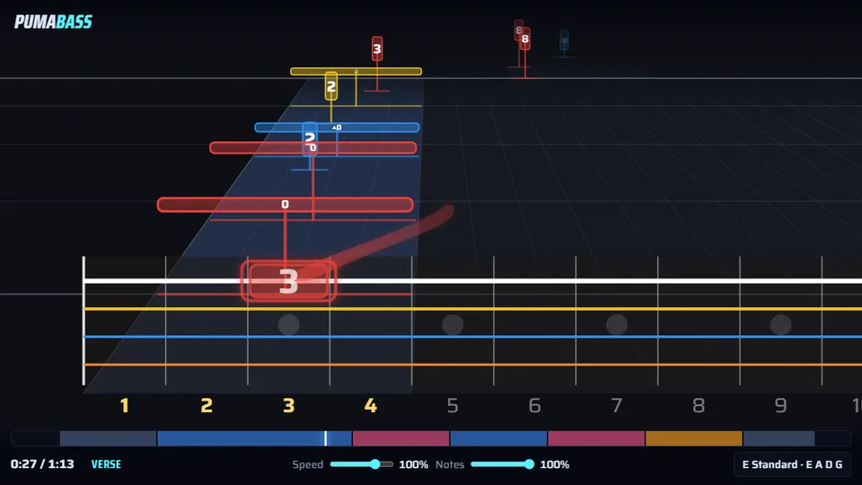
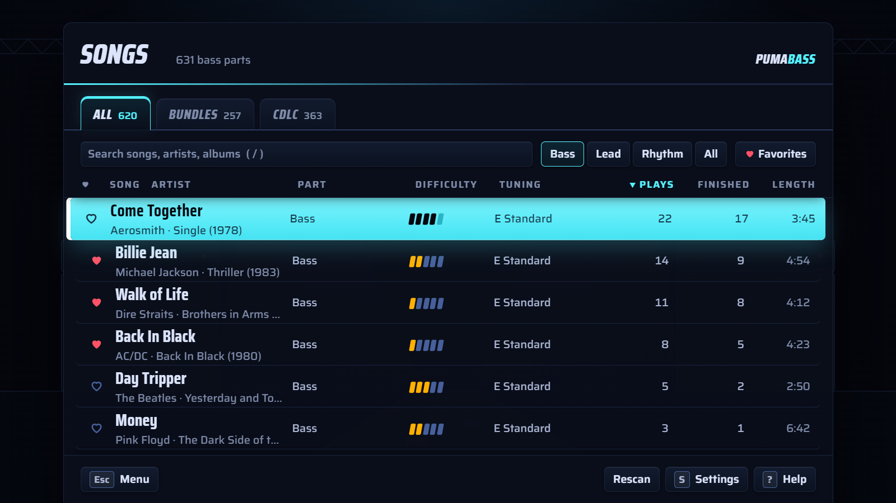
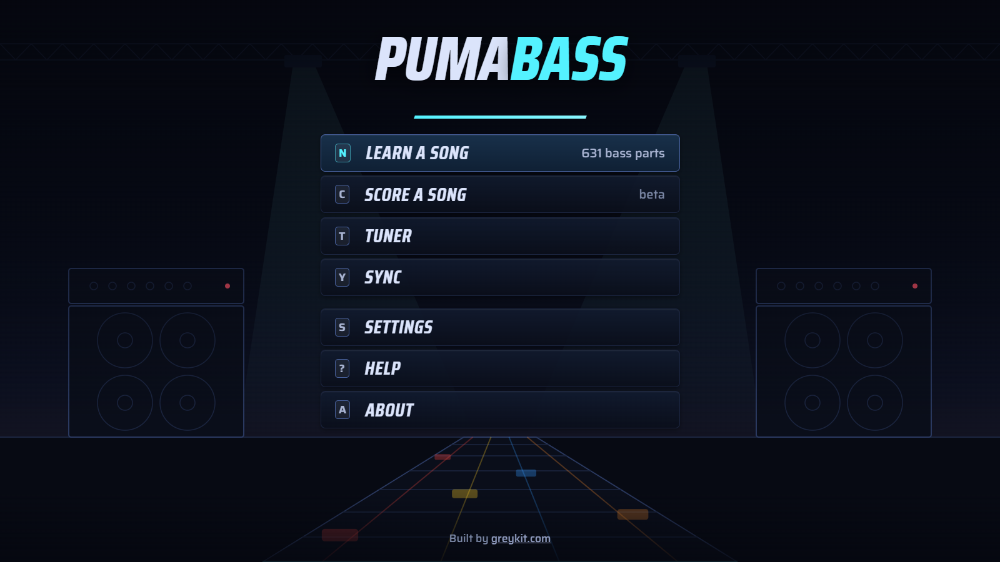
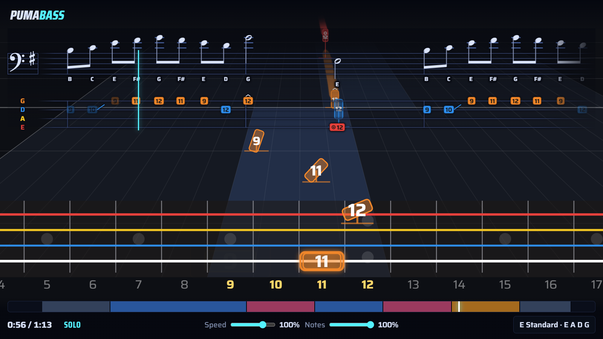
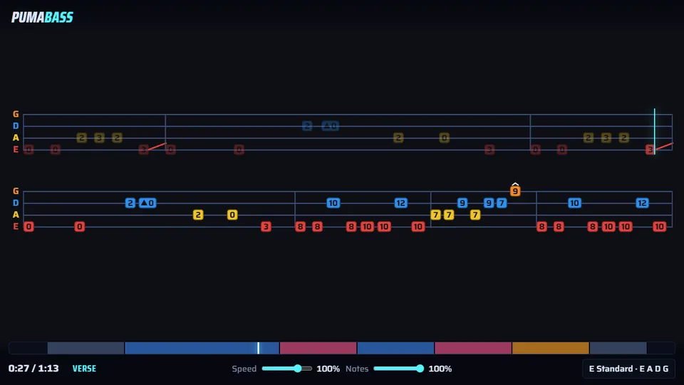

# PumaBass

Play the Rocksmith 2014 songs you already own on a note highway, without Steam or Rocksmith. Bass
first; lead and rhythm guitar parts play too. You give PumaBass your own song files (`.psarc`) and it
plays them in your browser; until then, there's a demo song written for it to play. Runs on Windows
and Linux, from a desk or from the couch on a TV. Built by [greykit.com](https://greykit.com).

**Try the demo in your browser** at [greykit.com/games/pumabass](https://greykit.com/games/pumabass/),
with nothing to install.



## What you get

- **The note highway.** Notes come down the strings towards you and land when it's time to play them.
  The camera follows your hand up and down the neck, closing in on low positions and pulling back for
  big moves. Slides, bends, hammer-ons, mutes and chords are marked the way Rocksmith marks them.
- **Notation or tab.** Standard notation and tab scroll over the highway so you can learn to read while
  you play, or swap the highway for a full page of tab.
- **Practice tools.** Slow a song down without changing its pitch, loop a section, let the riff repeater
  speed a loop up each time round, and pick an easier level of the chart.
- **A tuner** that knows each song's tuning, and the Real Tone Cable plays your bass through the game.
- **Scoring (beta).** Each note you play is judged as it lands, with a score at the end.
- **Your library.** Search, sort by difficulty or plays, heart your favorites, and see how often you've
  finished each song.
- **A demo song.** *Prowl*, an original riff written for PumaBass, is ready to play from the first run
  (below).

## Install

You need [Node.js](https://nodejs.org) 18 or newer, and vgmstream, which decodes the songs' audio.
Download or clone PumaBass, then:

**Windows**: run `tools/get-vgmstream.sh` once from Git Bash (or unzip `vgmstream-win64.zip` from
[vgmstream's releases](https://github.com/vgmstream/vgmstream/releases) into `tools/vgmstream/`),
then double-click **start.bat**.

**Linux**:

```bash
./tools/get-vgmstream.sh
./start.sh
```

PumaBass opens in your browser at http://localhost:8014/ (without a desktop, open that address
yourself). Close the window it started in, or press Ctrl+C there, to stop it.

**Try it straight away** with the demo song: **Learn a song**, then *Prowl* on the **Demo** tab. It's
a minute-long riff in E minor at 112 BPM. It starts low around the open E, moves up the neck for the
chorus, and climbs to the 12th fret in the solo, with a slide, bends and a harmonic. With **Notes**
below 50% it's quarter notes, for a first go.

## Add your songs



Put your Rocksmith 2014 song files in these folders beside PumaBass. Each gets its own tab on the song
list once it has songs:

- `bundles/`: Rocksmith's own song sets, such as the on-disc songs and the Rocksmith 1 import packs.
- `cdlc/`: custom songs you download, such as from CustomsForge.
- `music/`: songs you made, and recordings for charts that have no audio (below).

Or point PumaBass at a Rocksmith folder you already have (a whole Rocksmith install, a copied `dlc`
folder, a USB stick) in **Settings → Songs**; it gets a tab of its own, and nothing in it is changed.
Folders inside these folders are read too, and a song in more than one place is listed once. Press
**Rescan** after adding songs.

- PC (`_p.psarc`) and Mac (`_m.psarc`) files both work.
- The songs on the Rocksmith disc keep their charts in `songs.psarc` and their audio in
  `audio.psarc`: copy both.
- The Rocksmith 1 DLC import pack (`rs1compatibilitydlc_p.psarc`) keeps its audio in the disc's
  `songs.psarc`: copy that too, or its songs have no audio.
- Decoded audio is cached in `cache/audio` (kept under about 3 GB).

**Songs without audio.** To play a chart that has no audio, drop your own recording into `music/`
named `Artist - Title.mp3` (or just `Title.mp3`) and press **Rescan**. mp3, ogg, flac, m4a and wav work.
Settings → Song list → **Show them** lists the charts still waiting for one. Line it up with the song's
audio offset (in the mix, `M`), which goes up to ±15 s for these.

**A page of your songs.** `node tools/cdlc-index.mjs` writes `cdlc/index.html`, listing every song file
there (parts, bass difficulty, tuning, length) with a link to each; open it from disk. Add a folder name
to list another one: `node tools/cdlc-index.mjs bundles`.

## Playing



**Learn a song** plays along: nothing is marked, and if the Real Tone Cable is plugged in you hear
yourself with the song. **Score a song** is the same list, scored (see Scoring).

In the song list, `/` searches, Up / Down move, Enter plays and `F` hearts a favorite. **Difficulty** is
Rocksmith's own rating for each part, shown as 1 to 5 bars; sort by it for the easiest first.

In a song:

| Key | Action |
| --- | --- |
| Space | Play / pause (playing again starts 6 s back and counts you in) |
| Left / Right | Back / forward 5 seconds |
| Up / Down | Faster / slower (the pitch stays the same) |
| L | Loop the current section (again to stop) |
| R | Riff repeater: the loop, a little faster each time round |
| [ / ] | Set the loop's start / end at the current spot |
| Shift + click the progress bar | Move the nearest loop edge there |
| Home | Back to the loop's start (or the song's) |
| M | The mix: your bass, the song, this song's audio offset |
| T | The tuner |
| V | The view: the highway, or tab in its place |
| N | The notation over the highway: standard notation, tab, both, off |
| B | The record's own bass: full, reduced, cut |
| F | Make the song a favorite |
| Mouse wheel (paused) | Scrub |
| S / ? | Settings / Help |
| Esc | Back to the song list, then the menu |

- **Notes** (the slider by Speed): 100% is the full chart; lower values use Rocksmith's simpler levels.
- **Riff repeater**: loops the section from 60% speed up to full in 5% steps. When scoring, a time round
  only speeds up when you hit 70% of its notes.
- **The end screen** says how far you got and whether it counted as finished. `R` or `Space` plays it
  again, `Esc` goes to the song list, `M` to the menu; when scoring, `P` practises the section you
  found hardest.
- **Plays** counts each time you start a song; **Finished**, each time you played it to its last note,
  having played at least half of it. They're kept in your browser with the rest of your settings.

## Reading music



Over the highway, the part scrolls by in **standard notation over tab**, as a printed bass chart has it.
Notes cross the blue playhead as you play them. `N` steps through notation, tab, both and off;
Settings → Notation also turns the note names under the notes on and off, and Settings → Highway can put
note names on the highway's notes instead of fret numbers.

The tab's notes are chips in their strings' colours, as on the highway, with the same marks for slides,
bends and other techniques, and chord names over the tab where the chord changes. With a capo, the tab
counts frets from the capo.



**Tab view** (`V`, or Settings → View) puts the tab, large, in the highway's place, laid out like a page:
the current line on top, the next below it. The cyan line runs along as you play, drops to the next line
at the end, and the lines move up to bring in the one after.

## Your bass: the cable, the tuner and the mix

Plug your bass into the Rocksmith Real Tone Cable and press **T** (or **Tuner** on the menu). The first
time, the browser asks to let PumaBass use audio inputs: allow it. The cable is found by name; any other
input (an audio interface, a microphone) can be chosen in **Settings → Instrument input**.

- **The tuner** aims for the song's tuning, including songs that sit a few cents off A440, and ticks each
  string off once it holds within 3 cents. It opens by itself on the first song of the day and when a song
  needs a different tuning from the last.
- **Hear your bass** plays the cable through PumaBass, so you don't need an amp. There's a short delay on
  the way; if you play through an amp with a splitter, turn it off.
- **The mix** (`M` in a song): **Your bass** boosts the cable's quiet signal (up to +30 dB), **Song** sets
  the record's level, and a meter on each helps you match them.
- **Recorded bass** (`B`): Full, Reduced or Cut. Records have no separate bass track, so Cut takes the
  low end out of the middle of the mix. Most of the bass goes; a little of its upper ring stays, and the
  kick drum loses some thump.
- Inputs only work when PumaBass is opened as `http://localhost:…` on the computer it runs on.

## Timing

**Sync** (on the menu, `Y`) lines up the picture, the sound and the cable. Run it once, and again when
you change speakers, headphones or screen (Bluetooth and TVs add delay).

1. **Line up.** A tick sounds on every beat while a bar swings from side to side. Move the bar (`←` / `→`,
   `Shift` for bigger steps) until it lands right on the tick, then `Enter`.
2. **Play along** (with the cable). Pluck the open E string with the notes. This measures how late your
   playing reaches PumaBass, for scoring.
3. **Soundcheck**, inside the play-along. Keep the strings quiet through the count-in so the cable's
   own hum can be measured, then play. It tells you whether your level is good, too loud, or too quiet,
   and what to turn. **Use these** keeps the result.

`Esc` at any point leaves without changing anything. Each song also has its own audio offset (in the mix, `M`) on top.

## Scoring (beta)

**Score a song** (`C`) judges each note as it lands, through the cable: a ring in the string's colour
for a hit, a red cross for a miss, with accuracy and streak at the top. The end screen gives the score,
best streak, whether you tend to play early or late, how each section went, and your best accuracy.

- A note counts when it's plucked within 200 ms early to 300 ms late (Rocksmith 2014's own windows) at
  the right pitch. Slowed-down practice is judged the same.
- It's forgiving of a muddy signal: a note still ringing, an open string nobody muted, a soft pluck.
- Hammer-ons and pull-offs need the new note; mutes and harmonics just the pluck; chords just the strum
  (a wrong chord shape isn't caught yet).
- Run **Sync** with the cable first: scoring depends on it.

## Playing on a TV

On a big screen PumaBass draws everything larger so it reads from the couch. At a desk, **Settings →
Screen → Computer, up close** turns that off. While it's open it keeps the screen from sleeping; if a
set-top PC still blanks mid-song, turn its screensaver or display power saving off (e.g. `xset s off -dpms`).

To start PumaBass with a Linux computer, `tools/pumabass.service` runs it as a systemd user service (the
steps are in the file); point a full-screen browser at it, e.g. `chromium --kiosk http://localhost:8014/`.
A kiosk browser may have nowhere to ask for the cable: allow it once in a normal window first (Chromium
remembers), or by policy, with `{ "AudioCaptureAllowedUrls": ["http://localhost:8014"] }` in
`/etc/chromium/policies/managed/pumabass.json`.

## Settings file and options

Settings live in `config.json` beside PumaBass. You can edit it by hand:

```json
{ "libraryDir": "/media/me/songs", "port": 8014, "host": "127.0.0.1", "musicDir": "/home/me/bass-recordings" }
```

| Key | What | Default |
| --- | --- | --- |
| `libraryDir` | a Rocksmith folder of your own, on its own tab | none: chosen in Settings |
| `port` | the address's port | 8014 |
| `host` | who may connect: `127.0.0.1` is this computer only; `0.0.0.0` lets other devices on your network in (they can then see your folder names in the picker) | `127.0.0.1` |
| `bundlesDir` | the Bundles folder | `bundles/` |
| `cdlcDir` | the CDLC folder | `cdlc/` |
| `musicDir` | the Music folder | `music/` |
| `cacheDir` | decoded audio and the song index | `cache/` |
| `openBrowser` | open a browser on start | `true` |

For one run: `./start.sh --port 8015 --library /path/to/songs --no-open` (start.bat takes the same).

vgmstream is found in `tools/vgmstream/` or on your `PATH`. Its Linux build is for x86-64 computers;
on ARM, build vgmstream from source.

## More

Help and About are on the title menu. Notation is drawn by [VexFlow](https://www.vexflow.com/) (MIT).
How PumaBass is built and tested is in [DEVELOPING.md](DEVELOPING.md).
